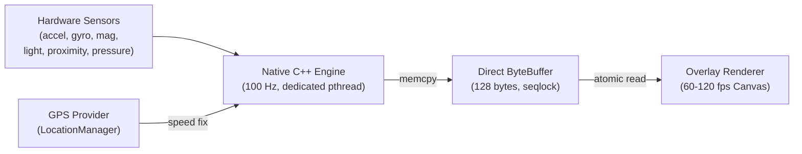

<p align="center">
  
</p>

<h1 align="center">MotionClue</h1>

<p align="center">
  Real-time vehicle motion cues for Android (API 26+).<br>
  Mitigates passenger motion sickness through peripheral visual cues. Fully offline, open source.
</p>

<p align="center">
  <a href="https://github.com/SniperOfTDM/MotionClue/releases/latest"></a>
  <a href="https://github.com/SniperOfTDM/MotionClue/actions/workflows/build.yml"></a>
  <a href="LICENSE"></a>
  <a href="app/build.gradle.kts"></a>
  <a href="app/src/main/cpp/CMakeLists.txt"></a>
  <a href="#privacy"></a>
</p>

---

## Overview

Using a screen inside a moving vehicle induces kinetosis (motion sickness). While the vestibular system registers accelerations, braking, and angular turns, the visual field remains largely static relative to the handset. This mismatch between vestibular and ocular signals triggers autonomic distress, nausea, and fatigue.

MotionClue displays non-intrusive animated markers along the screen margins that mirror real-time vehicle dynamics. By providing a consistent peripheral visual reference aligned with physical motion, MotionClue resolves sensory conflict without obstructing foreground applications, media playback, or reading interfaces.

---

## Technical Architecture

The core sensor fusion and physics calculations execute in native C++17 on a dedicated POSIX thread. This design bypasses Android Runtime garbage collection pauses to maintain consistent 100 Hz signal ingestion and sub-millisecond dispatch.



### Signal Processing Pipeline

1. **Hardware Sampling**: Reads accelerometer, gyroscope, magnetometer, barometer, ambient light, and proximity sensors via Android NDK `ASensorEventQueue`.
2. **Gravity Separation**: Employs a complementary filter with gyroscope integration and dynamic acceleration gating to decouple linear acceleration from Earth gravity.
3. **Display Frame Rotation**: Projects three-axis acceleration vectors into the active viewport coordinates across orientation changes.
4. **Vibration Rejection**: Directs linear signals through an IIR biquad bandpass filter, removing DC sensor drift and high-frequency road vibrations.
5. **Spring Dynamics**: Evaluates a second-order critically damped harmonic oscillator to transform net forces into sub-pixel marker offsets.
6. **Speed Fusion**: Blends GPS velocity with longitudinal acceleration to derive continuous margin flow rates.
7. **Lock-Free Publication**: Serializes frame states into a 128-byte shared buffer guarded by a sequence lock (seqlock).
8. **Composition**: The Kotlin overlay reads frame updates during Choreographer vsync intervals and renders via hardware-accelerated Canvas.

---

## Features

### Motion Dynamics
- Second-order spring-damper model tuned to vehicle lateral and longitudinal forces.
- Inertial speed flow rendering along display edges proportional to road speed.
- Complementary orientation filter ensuring stable vertical references during banking turns.

### Transport Profiles
- **Automobile**: Calibrated for stop-and-go traffic, intersection turns, and highway acceleration.
- **Bus / Transit**: Damped for prolonged deceleration cycles and frequent stop sequences.
- **Rail**: Tuned for high-velocity steady state travel and gradual track curvatures.
- **Maritime**: Filtered for low-frequency roll, pitch, and heave motions.

### Power & Lifecycle Gating
- **Walking Detection**: Built-in step detector and kinetic energy gating automatically pause the engine when on foot.
- **Stationary Sleep**: Zero-motion thresholds suspend heavy math when the vehicle is parked.
- **Pocket Detection**: Proximity sensor halts overlay draw passes while enclosed in a pocket or bag.
- **Ambient Adaptation**: Light sensor dynamically scales marker luminance to match surrounding lux levels.

### System Integration
- Non-blocking system overlay (`TYPE_APPLICATION_OVERLAY`) passing all touch events to underlying apps.
- Quick Settings tile for immediate toggle access.
- Material You dynamic color alignment on Android 12+.
- Full orientation handling across portrait, reverse portrait, and landscape orientations.

---

## Comparison

| Capability | Apple Vehicle Motion Cues | Google Motion Assist | KineStop | MotionClue |
|:---|:---:|:---:|:---:|:---:|
| **Minimum Platform** | iOS 18+ | Android 17+ | Android 5.0+ | **Android 8.0+ (API 26)** |
| **Supported Devices** | Apple devices only | Selected Pixel flagships | Play Store | **All Android devices** |
| **License** | Proprietary | Proprietary | Closed Source | **GNU GPL-3.0** |
| **Network Requirement** | Offline | Play Services dependent | Ad-supported | **100% Offline (No INTERNET)** |
| **Sensor Engine** | OS Native | OS Native | Java service | **Native C++17 (Zero GC)** |
| **Damped Spring Model** | Yes | Yes | Basic horizon | **Second-order critically damped** |
| **Speed Flow Mode** | No | No | No | **Hybrid GPS + Inertia** |
| **Transport Presets** | No | No | No | **Car, Bus, Rail, Marine** |
| **Walking Auto-Pause** | Yes | Partial | No | **Hardware step detector** |
| **Proximity Pocket Sensor**| No | No | No | **Supported** |
| **Ambient Lux Scaling** | No | No | No | **Supported** |

---

## Installation

### Download Package
Pre-compiled APK packages are available on the [Releases](https://github.com/SniperOfTDM/MotionClue/releases) page.

### Build from Source

Requirements:
- Android SDK (API 36 compile SDK, API 26 minimum)
- Android NDK (r27+ / 28.2.13676358)
- JDK 17 or JDK 21

```bash
git clone https://github.com/SniperOfTDM/MotionClue.git
cd MotionClue
./gradlew assembleDebug
```

The output artifact is generated at:
`app/build/outputs/apk/debug/app-debug.apk`

---

## Privacy & Permissions

MotionClue requires no network access. The `android.permission.INTERNET` declaration is omitted from the manifest, guaranteeing that sensor, GPS, and runtime data never leave the local handset.

| Permission | Technical Justification |
|:---|:---|
| `SYSTEM_ALERT_WINDOW` | Renders the overlay surface on top of other running applications. |
| `FOREGROUND_SERVICE` | Maintains sensor acquisition threads while the display is illuminated. |
| `FOREGROUND_SERVICE_SPECIAL_USE` | Required by Android 14+ policies for persistent overlay services. |
| `FOREGROUND_SERVICE_LOCATION` | Permits continuous GPS velocity reads in the foreground service scope. |
| `ACCESS_FINE_LOCATION` | Obtains ground speed metrics used by the speed-flow visualization mode. |
| `POST_NOTIFICATIONS` | Displays the mandatory foreground service notification on Android 13+. |

---

## Device-Specific Configuration

Certain Android distributions (such as Xiaomi HyperOS/MIUI, OPPO ColorOS, and Huawei EMUI) apply aggressive background task termination. If the overlay closes unexpectedly, apply these standard permissions:

1. **Display Pop-up Windows**: Settings > Apps > MotionClue > Permissions > Display pop-up windows (Enable).
2. **Autostart**: Settings > Apps > MotionClue > Autostart (Enable).
3. **Battery Restrictions**: Settings > Apps > MotionClue > Battery Saver > Set to **No Restrictions**.
4. **Task Locking**: In the Recent Apps switcher, lock MotionClue to prevent memory reclamation.

---

## Contributing

Review [CONTRIBUTING.md](CONTRIBUTING.md) for contribution guidelines, branch standards, and NDK build requirements.

---

## License

MotionClue is licensed under the [GNU General Public License v3.0](LICENSE).
