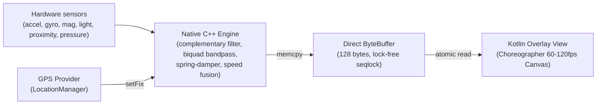

# MotionClue

Vehicle Motion Cues for every Android phone (Android 8.0+). Reduce motion sickness while using your screen on the road.

[](https://github.com/SniperOfTDM/MotionClue/actions/workflows/build.yml)
[](LICENSE)
[-brightgreen.svg)](app/build.gradle.kts)
[](build.gradle.kts)
[](app/src/main/cpp/CMakeLists.txt)
[](#privacy)

<!-- Replace with the real GIF once recorded: docs/media/demo.gif -->
> **Demo GIF placeholder** — see [Recording instructions](#recording-a-demo-gif) below.

---

## Why MotionClue?

Using a smartphone in a moving vehicle triggers motion sickness (*kinetosis*). Your vestibular system (inner ear) feels physical acceleration, braking, and turns, but your eyes focus on a stationary display. This sensory mismatch confuses the brain, causing nausea, fatigue, and headaches.

MotionClue places subtle, animated dots along screen margins that shift and flow in real time with vehicle physics. By providing a peripheral visual motion reference, MotionClue bridges the sensory conflict between your eyes and inner ear without obstructing your apps, text, or videos.

---

## Comparison With Alternatives

| Feature | Apple Vehicle Motion Cues | Google Motion Assist | KineStop | MotionClue |
|:---|:---:|:---:|:---:|:---:|
| **Platform** | iOS 18+ only | Android 17+ only | Android 5.0+ | **Android 8.0+ (API 26+)** |
| **Availability** | Apple devices | Newer Pixel/Flagships | Play Store | **Any Android device** |
| **Open Source** | ❌ Proprietary | ❌ Proprietary | ❌ Closed Source | **✅ GPL-3.0** |
| **Privacy / No Internet** | ✅ | ❓ (Play Services) | ❌ Ad-supported | **✅ 100% Offline (No INTERNET perm)** |
| **Processing Engine** | OS Native | OS Native | Java service | **Native C++ (Zero GC jitter)** |
| **Lock-free Shared Buffer**| OS | OS | ❌ | **✅ Seqlock (120-byte payload)** |
| **Inertial Spring Model** | ✅ | ✅ | Basic horizon | **✅ 2nd-order damped spring** |
| **GPS Speed Flow Mode** | ❌ (Turns/Accel only) | ❌ (Turns/Accel only) | ❌ | **✅ Hybrid Blend (Inertia + Speed)** |
| **Vehicle Presets** | ❌ | ❌ | ❌ | **✅ Car, Bus, Train, Boat** |
| **Walking Detection Pause**| ✅ | ❓ | ❌ | **✅ Step detector + energy gating** |
| **Adaptive Brightness** | ❌ | ❌ | ❌ | **✅ Ambient light sensor** |
| **Pocket Auto-Hide** | ❌ | ❌ | ❌ | **✅ Proximity sensor** |

---

## Features

- **Click-through system overlay**: Runs smoothly on top of Chrome, YouTube, readers, or games.
- **Physical spring-damper model**: Dots react dynamically to cornering, braking, and acceleration.
- **GPS speed flow**: Dots stream along edges proportional to actual vehicular speed.
- **Transport presets**: One-tap profiles optimized for Car, Bus/Metro, High-Speed Train, and Boat.
- **Walking detection auto-pause**: Halts cues when on foot to avoid false triggers.
- **Adaptive ambient brightness**: Dims in darkness, brightens under direct sunlight.
- **Proximity pocket detection**: Turns off the overlay instantly when placed in a pocket or bag.
- **Material You Dynamic Colors**: Matches your system theme on Android 12+.
- **Quick Settings Tile**: One-tap toggle from anywhere.
- **Native C++ sensor thread**: 100 Hz sampling on a dedicated thread with zero JVM garbage collection pauses.
- **100% Offline and Private**: No `INTERNET` permission, zero telemetry, zero analytics.

---

## Architecture & How It Works



1. **Hardware sampling**: Sensor events arrive at 100 Hz on a dedicated pthread.
2. **Gravity separation**: Complementary filter with gyro-predictive integration and accelerometer gating.
3. **View-frame rotation**: Rotates device acceleration into display coordinates based on screen orientation.
4. **Biquad band-pass**: High-pass eliminates DC drift, low-pass strips engine and road vibrations.
5. **Spring dynamics**: 2nd-order critically damped model integrates forces into smooth sub-pixel shifts.
6. **Speed fusion**: GPS speed combines with forward acceleration for continuous speed-flow rates.
7. **Lock-free publishing**: Native engine writes 120-byte state into a shared seqlock buffer.
8. **Render loop**: Kotlin overlay reads the buffer during display vsync via Choreographer.

---

## Install

### Download APK
Download the latest APK from the [Releases](https://github.com/SniperOfTDM/MotionClue/releases) page.

### Build From Source
```bash
git clone https://github.com/SniperOfTDM/MotionClue.git
cd MotionClue
./gradlew assembleDebug
```
The output APK is generated at `app/build/outputs/apk/debug/app-debug.apk`.

---

## Permissions

| Permission | Purpose |
|:---|:---|
| `SYSTEM_ALERT_WINDOW` | Renders the motion dots on top of active applications |
| `FOREGROUND_SERVICE` | Keeps sensor fusion active with the screen on |
| `FOREGROUND_SERVICE_SPECIAL_USE` | Required on Android 14+ for foreground overlay services |
| `FOREGROUND_SERVICE_LOCATION` | Allows reading GPS speed while active |
| `ACCESS_FINE_LOCATION` | Computes vehicle speed for the flowing dot cue |
| `POST_NOTIFICATIONS` | Foreground service notification on Android 13+ |

---

## Xiaomi / HyperOS / MIUI Setup

Aggressive battery managers on HyperOS, MIUI, and ColorOS can terminate background overlays. To ensure uninterrupted operation:

1. **Overlay permission**: Settings → Apps → MotionClue → Other permissions → Display pop-up windows (Enable)
2. **Autostart**: Settings → Apps → MotionClue → Autostart (Enable)
3. **Battery Saver**: Settings → Apps → MotionClue → Battery saver → **No restrictions**
4. **Lock in Recents**: Open MotionClue, open App Switcher, long-press the card and select **Lock**

---

## Recording a Demo GIF

1. Enable screen recording on your phone (or run `adb shell screenrecord /sdcard/demo.mp4`).
2. Open MotionClue, start the overlay, and tilt/move the device or ride in a vehicle.
3. Keep the clip under 12 seconds.
4. Convert to GIF (e.g., using ffmpeg):
   ```bash
   ffmpeg -i demo.mp4 -vf "fps=20,scale=360:-1:flags=lanczos" -loop 0 docs/media/demo.gif
   ```
5. Place the resulting file at `docs/media/demo.gif`.

---

## Contributing

Pull requests are welcome. See [CONTRIBUTING.md](CONTRIBUTING.md) for architecture details and sensor test submission guides.

---

## License

[GNU General Public License v3.0 (GPL-3.0)](LICENSE)
