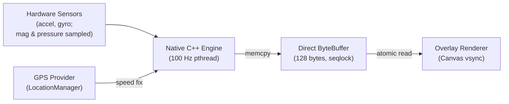

<p align="center">
  
</p>

<h1 align="center">MotionClue</h1>

<p align="center">
  Peripheral visual motion cues for passenger vehicles on Android (API 26+).<br>
  Mitigates motion-sickness symptoms through responsive screen-edge markers. Fully offline and open source.<br>
  <sub>Inspired by Apple's Vehicle Motion Cues. Not affiliated with or endorsed by Apple Inc. or Google LLC.</sub>
</p>

<p align="center">
  <b>Status:</b> v1.0.0 release. Tested primarily on Poco X7 Pro (Android 15); formal battery profiling and automated tests pending.
</p>

<p align="center">
  <a href="https://github.com/SniperOfTDM/MotionClue/releases/latest"></a>
  <a href="https://github.com/SniperOfTDM/MotionClue/actions/workflows/build.yml"></a>
  <a href="LICENSE"></a>
  <a href="app/build.gradle.kts"></a>
  <a href="app/src/main/cpp/CMakeLists.txt"></a>
  <a href="#privacy--permissions"></a>
</p>

> **Passenger use only:** MotionClue is intended solely for passengers and must never be used while driving or operating a vehicle.

---

## Overview

According to the sensory conflict theory of motion sickness, symptoms arise when vestibular signals registering vehicle acceleration, braking, and turns conflict with a stationary visual field while focusing on a handset display.

MotionClue displays non-intrusive animated markers along the screen margins that mirror physical vehicle dynamics. By providing a consistent peripheral visual reference aligned with vehicle motion, MotionClue is designed to help ease sensory conflict without obstructing foreground applications, media playback, or reading interfaces.

*Not a medical device. Intended to help reduce motion-sickness symptoms; individual results vary.*

---

## Safety & Limitations

- **Passenger use only**: MotionClue must never be used while driving or operating a vehicle.
- **Medical disclaimer**: Not a medical device; does not cure kinetosis and individual efficacy varies.
- **Hardware sensors**: Requires on-device motion sensors (accelerometer and gyroscope) to compute motion cues.
- **Walking auto-pause**: Step detection requires `android.permission.ACTIVITY_RECOGNITION` on Android 10+ (API 29+), which is unrequested in the current release; walking auto-pause may not trigger without this permission ([Issue #2](https://github.com/SniperOfTDM/MotionClue/issues/2)).
- **Overlay visibility**: Android may hide or block overlay surfaces over secure windows (`FLAG_SECURE`), banking applications, DRM media playback, and system permission dialogs.
- **Battery impact**: Battery impact has not been formally measured (source: [docs/TESTING.md](docs/TESTING.md)); the engine samples motion sensors at 100 Hz and uses GPS while active, suspending heavy math only when stationary thresholds are met.
- **Hardware testing**: Tested primarily on a single physical device (Poco X7 Pro, Android 15 / HyperOS).

---

## Technical Architecture

The core sensor fusion and physics calculations execute in native C++17 on a dedicated POSIX thread. The native sensor thread runs outside the JVM, avoiding JVM garbage collection pauses during sensor sampling and physics evaluation. Rendering (Choreographer/Canvas), UI (Jetpack Compose), and location services run on ART/JVM and are subject to normal garbage collection. Sensor events are processed directly in native code via `ASensorEventQueue` without JNI marshalling overhead per sample.



### Signal Processing Pipeline

1. **Hardware Sampling**: Reads accelerometer and gyroscope; magnetometer (heading orientation reference) and barometer (ambient pressure / altitude climb rate) are sampled native sensors documented in [docs/ARCHITECTURE.md](docs/ARCHITECTURE.md).
2. **Gravity Separation**: Employs a complementary filter with gyroscope integration to decouple linear acceleration from Earth gravity.
3. **Display Frame Rotation**: Projects three-axis acceleration vectors into the active viewport coordinates across orientation changes.
4. **Vibration Rejection**: Directs linear signals through an IIR biquad bandpass filter, removing DC sensor drift and high-frequency road vibrations.
5. **Spring Dynamics**: Evaluates a second-order damped spring model to transform net forces into sub-pixel marker offsets.
6. **Speed Fusion**: Blends GPS velocity with longitudinal acceleration to derive continuous margin flow rates.
7. **Lock-Free Publication**: Serializes frame states into a 128-byte shared buffer guarded by a sequence lock (seqlock).
8. **Composition**: The Kotlin overlay reads frame updates during Choreographer vsync intervals and renders via hardware-accelerated Canvas.

---

## Features

### Motion Dynamics
- Second-order damped spring model calibrated to vehicle lateral and longitudinal forces.
- Inertial speed flow rendering along display edges proportional to road speed.
- Complementary orientation filter providing vertical references during banking turns.

### Transport Profiles
- **Automobile**: Calibrated for stop-and-go traffic, intersection turns, and highway acceleration.
- **Bus / Transit**: Damped for prolonged deceleration cycles and frequent stop sequences.
- **Rail**: Tuned for steady high-velocity travel and gradual track curvatures.
- **Maritime**: Filtered for low-frequency roll, pitch, and heave motions.

### Power & Lifecycle Gating
- **Walking Detection**: Step detector and kinetic energy gating suspend processing on foot (requires runtime permission configuration on Android 10+).
- **Stationary Sleep**: Stationary thresholds suspend heavy math when the vehicle is parked.
- **Pocket Detection**: Proximity sensor halts overlay draw passes while enclosed in a pocket or bag.
- **Ambient Adaptation**: Light sensor dynamically scales marker luminance to match surrounding lux levels.

### System Integration
- Non-blocking system overlay (`TYPE_APPLICATION_OVERLAY`) passing touch events to underlying apps.
- Quick Settings tile for immediate toggle access.
- Material You dynamic color alignment on Android 12+.
- Coordinate transformation across portrait and landscape orientations.

---

## Comparison

*Comparison as of 2026-11-03.*

| Capability | Apple Vehicle Motion Cues | Google Motion Assist | KineStop | MotionClue |
|:---|:---:|:---:|:---:|:---:|
| **Platform** | iOS 18+ | Android 17+ | Android 5.0+ | Android 8.0+ (API 26+) |
| **Supported Devices** | Apple devices only | Selected Pixel flagships | Play Store devices | Android 8.0+ with motion sensors |
| **License** | Proprietary | Proprietary | Closed Source | GNU GPL-3.0 |
| **Network Requirement** | Offline | Play Services dependent | Ad-supported | Offline (No INTERNET permission) |
| **Visual Cues** | Screen-edge dots | Screen-edge shapes | Customizable artificial horizon | Responsive margin markers |
| **Speed Flow Mode** | Not verified | Not verified | Not verified | Hybrid GPS + Inertia |
| **Transport Presets** | Not verified | Not verified | Not verified | Car, Bus, Rail, Marine |
| **Walking Auto-Pause** | Supported | Partial | Not verified | Hardware step detector (API < 29) |
| **Pocket Sensor** | Not verified | Not verified | Not verified | Supported (Proximity) |
| **Ambient Lux Scaling** | Not verified | Not verified | Not verified | Supported (Light sensor) |

<details>
<summary>Technical differences</summary>

| Implementation Aspect | Apple Vehicle Motion Cues | Google Motion Assist | KineStop | MotionClue |
|:---|:---:|:---:|:---:|:---:|
| **Processing Engine** | OS Native | OS Native | Java service | Native C++17 thread |
| **Shared Buffer** | OS internal | OS internal | Not verified | 128-byte seqlock Direct ByteBuffer |
| **Dynamics Model** | Damped spring | Damped spring | Horizon pitch/roll | Second-order damped spring |

</details>

---

## Installation

### Download Package

Pre-compiled APK packages are available on the [Releases](https://github.com/SniperOfTDM/MotionClue/releases) page. The release asset `MotionClue-v1.0.0.apk` is an assembleDebug build signed with the Android debug keystore (SHA-256: `68c79d926a6df42cbbf7a688f6e7a250edd3843dec5c3d4150fd1d000290f45d`).

### For Developers

Prerequisites:
- Android SDK (API 36 compile SDK, API 26 minimum)
- Android NDK 28.2.13676358
- CMake 3.22.1
- JDK 17
- Gradle 8.9 (wrapper included)

```bash
git clone https://github.com/SniperOfTDM/MotionClue.git
cd MotionClue
./gradlew assembleDebug
./gradlew assembleRelease
```

Debug output artifact: `app/build/outputs/apk/debug/app-debug.apk`

---

## Privacy & Permissions

MotionClue requires no network access. The app declares no `INTERNET` permission, preventing network transmission from the app process. Sensor, GPS, and runtime state remain on the local handset.

| Permission | Technical Justification |
|:---|:---|
| `SYSTEM_ALERT_WINDOW` | Renders the overlay surface on top of other running applications. |
| `FOREGROUND_SERVICE` | Maintains sensor acquisition threads while the display is illuminated. |
| `FOREGROUND_SERVICE_SPECIAL_USE` | Required by Android 14+ policies for persistent overlay services. |
| `FOREGROUND_SERVICE_LOCATION` | Permits continuous GPS velocity reads in the foreground service scope. |
| `ACCESS_FINE_LOCATION` | Obtains ground speed metrics used by the speed-flow visualization mode. |
| `POST_NOTIFICATIONS` | Displays the mandatory foreground service notification on Android 13+. |

---

## Device-Specific Configuration

Certain vendor distributions (such as Xiaomi HyperOS, OPPO ColorOS, and Huawei EMUI) aggressively terminate background processes to maximize battery runtime at the expense of background services. For details by manufacturer, see [dontkillmyapp.com](https://dontkillmyapp.com). If the overlay closes unexpectedly, apply these standard configurations:

1. **Display Pop-up Windows**: Settings > Apps > MotionClue > Permissions > Display pop-up windows (Enable).
2. **Autostart**: Settings > Apps > MotionClue > Autostart (Enable).
3. **Battery Restrictions**: Settings > Apps > MotionClue > Battery Saver > Set to **No Restrictions**.
4. **Task Locking**: In the Recent Apps switcher, lock MotionClue to prevent memory reclamation.

---

## Contributing

Review [CONTRIBUTING.md](CONTRIBUTING.md) for contribution guidelines, build requirements, and demo recording steps. Manual test checklists are documented in [docs/TESTING.md](docs/TESTING.md).

---

## License

MotionClue is licensed under the [GNU General Public License v3.0](LICENSE).
