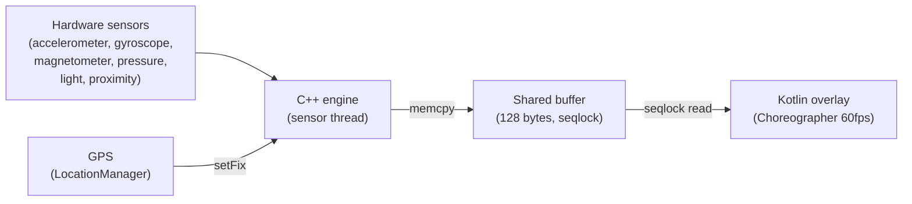

# MotionClue

Dot overlay that responds to vehicle motion to reduce motion sickness on Android.

[](https://github.com/SniperOfTDM/MotionClue/actions/workflows/build.yml)
[](LICENSE)
[](app/build.gradle.kts)
[](build.gradle.kts)
[](app/src/main/cpp/CMakeLists.txt)

<!-- Replace with the real GIF once recorded: docs/media/demo.gif -->
> **Demo GIF placeholder** — see [Recording instructions](#recording-a-demo-gif) below.

## Why

Using a phone in a moving vehicle can trigger motion sickness. The mismatch between what your eyes see (a static screen) and what your inner ear feels (acceleration, turns, braking) confuses the brain. MotionClue places small dots along the screen edges that shift and flow with the vehicle's motion, giving your peripheral vision a reference frame that matches the physical movement.

Inspired by the iPhone "Vehicle Motion Cues" feature introduced in iOS 18. MotionClue is an independent implementation with no Apple code, assets, or affiliation.

## Features

- Click-through overlay that works on top of any app
- Dots shift sideways in response to acceleration and turns
- Dots flow vertically when the vehicle is moving (GPS speed)
- Hybrid mode blends acceleration cues with speed-based flow
- Adaptive brightness dims dots in the dark, boosts in sunlight
- Proximity sensor hides dots when the phone is in a pocket
- Quick Settings tile for one-tap toggle
- Foreground service pauses on screen off, resumes on screen on
- All processing runs in a native C++ engine on a dedicated sensor thread
- Configurable dot size, color, opacity, count, and edge band width
- Stub engine fallback for devices where the native library cannot load
- Fully offline — no INTERNET permission, no analytics, no data collection

## How it works



The C++ engine runs on its own sensor thread. It reads raw accelerometer data, subtracts gravity, rotates into the view frame, and applies a spring-damped model to produce a shift vector. When GPS speed is available and the hybrid blend is above zero, the engine also produces a flow vector along the direction of travel. Both outputs are written to a 128-byte direct ByteBuffer using a seqlock. The Kotlin overlay reads this buffer every frame at display refresh rate and positions the dots accordingly.

When speed is unavailable or confidence is low, the engine falls back to acceleration-only mode. Flow direction is currently fixed to the screen-up axis in the display orientation.

## Sensors used

| Sensor | Purpose | Required |
|--------|---------|----------|
| Accelerometer | Detect lateral and longitudinal acceleration | Yes |
| Gyroscope | Improve orientation tracking, walking detection | Yes |
| Magnetometer | Compass heading for orientation reference | Optional |
| Gravity (HW) | Separate gravity from linear acceleration (uses software fallback if absent) | Optional |
| Linear acceleration (HW) | Direct linear acceleration if available | Optional |
| Rotation vector | Fused orientation | Optional |
| Game rotation vector | Orientation without magnetometer influence | Optional |
| Pressure (barometer) | Altitude change, climb rate | Optional |
| Light | Ambient lux for adaptive brightness | Optional |
| Proximity | Hide overlay when phone is in pocket | Optional |
| Step detector | Walking detection to pause cues | Optional |

Sensor availability is discovered at runtime via `ASensorManager`. The engine adapts to what the device provides. Run "Copy diagnostics" in the app to see which sensors your device exposes.

## Install

### From Releases

Download the APK from the [Releases](https://github.com/SniperOfTDM/MotionClue/releases) page and sideload it.

### Build from source

Requirements:
- Android Studio Ladybug or later
- JDK 17
- NDK 28.2.13676358
- CMake 3.22.1
- Gradle 8.9 (wrapper included)

```bash
git clone https://github.com/SniperOfTDM/MotionClue.git
cd MotionClue
./gradlew assembleDebug
```

The debug APK is at `app/build/outputs/apk/debug/app-debug.apk`.

## Permissions

| Permission | Why |
|-----------|-----|
| `SYSTEM_ALERT_WINDOW` | Draw the dot overlay on top of other apps |
| `FOREGROUND_SERVICE` | Keep the sensor engine running while the screen is on |
| `FOREGROUND_SERVICE_SPECIAL_USE` | Required by Android 14+ for overlays in foreground services |
| `FOREGROUND_SERVICE_LOCATION` | Access GPS speed while the service runs |
| `POST_NOTIFICATIONS` | Show the foreground service notification (Android 13+) |
| `ACCESS_FINE_LOCATION` | Read GPS speed and bearing for the flow effect |

### Privacy

MotionClue is fully offline. The manifest declares **no** `INTERNET` permission. No data leaves the device. No analytics, no crash reporting, no telemetry. GPS data is used only for speed and bearing, processed on-device, and never stored.

## Xiaomi / HyperOS setup

Xiaomi and HyperOS aggressively kill background services. Follow these steps to keep MotionClue running:

1. **Overlay permission**: Settings → Apps → MotionClue → Other permissions → Display pop-up windows (enable all three overlay toggles)
2. **Autostart**: Settings → Apps → MotionClue → Autostart → enable
3. **Battery saver**: Settings → Apps → MotionClue → Battery saver → No restrictions
4. **Lock in recents**: Open MotionClue, swipe up to recents, long-press the app card → Lock

These steps may also apply to other MIUI/HyperOS-based phones (Redmi, Poco). Other ROMs (Samsung OneUI, AOSP) generally do not need extra setup.

## Limitations

- Flow direction is fixed to the current display orientation in v0.1. It does not learn the actual travel direction from GPS bearing. This is a known simplification.
- Not a medical device. This app is an experimental comfort tool. It may help reduce motion sickness for some users but is not guaranteed to work for everyone.
- Tested primarily on one device: Poco X7 Pro (MediaTek Dimensity 8400-Ultra, HyperOS, Android 15). Sensor behavior, frame rates, and battery impact vary by device.
- Battery impact has not been formally measured. The native sensor thread and GPS updates consume power while the service is active.
- No automated tests exist. Testing is manual (see [docs/TESTING.md](docs/TESTING.md)).

## Roadmap

These features are planned but not yet implemented:

- **Axis learning**: learn the travel direction from GPS bearing instead of assuming screen-up
- **Presets**: save and switch between setting profiles (e.g. car, bus, train)
- **Kalman speedometer**: fuse accelerometer and GPS for smoother speed estimation
- **Sensor recording**: record raw sensor data to a file for offline analysis and tuning

## Contributing

See [CONTRIBUTING.md](CONTRIBUTING.md) for build setup, how to submit a sensor inventory from your phone, and contribution guidelines.

## License

[GNU General Public License v3.0 (GPL-3.0)](LICENSE)

All forks and derivative works must remain open source under GPL-3.0.

## Acknowledgements

- Inspired by the [Vehicle Motion Cues](https://support.apple.com/en-us/105104) feature in iOS 18. MotionClue is an independent reimplementation. It uses no Apple code, assets, or branding, and is not affiliated with or endorsed by Apple.

---

### Recording a demo GIF

1. Enable screen recording on your phone (or use `adb shell screenrecord`)
2. Start MotionClue, open any app, and tilt/move the phone to show the dots responding
3. Keep the recording under 15 seconds
4. Convert to GIF under 5 MB (e.g. with ffmpeg: `ffmpeg -i recording.mp4 -vf "fps=15,scale=360:-1" -loop 0 docs/media/demo.gif`)
5. Replace `docs/media/demo.gif.placeholder` with the real `docs/media/demo.gif`
