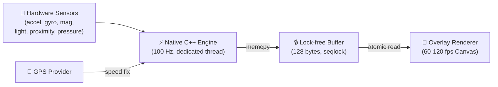

<p align="center">
  
</p>

<h1 align="center">MotionClue</h1>

<p align="center">
  <b>Stop motion sickness. Keep using your phone.</b><br>
  Real-time vehicle motion cues for Android — open source, 100% offline, zero tracking.
</p>

<p align="center">
  <a href="https://github.com/SniperOfTDM/MotionClue/releases/latest"></a>
  <a href="LICENSE"></a>
  <a href="https://github.com/SniperOfTDM/MotionClue/actions/workflows/build.yml"></a>
</p>

<p align="center">
  <a href="#"></a>
  <a href="build.gradle.kts"></a>
  <a href="app/src/main/cpp/CMakeLists.txt"></a>
  <a href="#privacy"></a>
</p>

---

<!-- Replace with actual screenshots once captured -->
<p align="center">
  <i>📱 Screenshots coming soon — see <a href="#recording-a-demo">Recording a Demo</a> below</i>
</p>

---

## The Problem

Reading, texting, or watching videos as a passenger triggers **motion sickness** (kinetosis). Your inner ear senses acceleration, braking, and turns — but your eyes see a static screen. This sensory mismatch causes nausea, headaches, and fatigue.

**Apple solved this for iOS 18.** Google's Motion Assist requires Android 17 and flagship Pixels.

MotionClue brings the same relief to **every Android phone since 2017**, completely free.

---

## How It Works

Subtle animated dots appear along your screen edges and respond in real time to vehicle physics. Your peripheral vision picks up these cues, bridging the gap between what your body feels and what your eyes see — without covering your apps.



---

## ✨ Features

<table>
<tr>
<td width="50%">

**🧠 Smart Motion Engine**
- 2nd-order spring-damped physics model
- Complementary gravity filter with gyro prediction
- Biquad bandpass strips vibration noise
- GPS + inertia hybrid speed fusion

</td>
<td width="50%">

**🚗 Vehicle Presets**
- Car — tuned for stop-and-go traffic
- Bus / Metro — optimized for frequent stops
- High-Speed Train — handles smooth high-velocity
- Boat / Ferry — adapted for wave motion

</td>
</tr>
<tr>
<td width="50%">

**🔋 Battery Aware**
- Walking auto-pause via step detector
- Pocket auto-hide via proximity sensor
- Adaptive brightness via ambient light sensor
- Stationary detection cuts processing at rest

</td>
<td width="50%">

**🎨 Native Experience**
- Material You dynamic colors (Android 12+)
- Quick Settings tile for one-tap toggle
- Click-through overlay — never blocks your apps
- Supports portrait + landscape rotation

</td>
</tr>
</table>

<p align="center">

**🔒 No Internet permission. No telemetry. No analytics. No ads. Ever.**

</p>

---

## Comparison

| | Apple Motion Cues | Google Motion Assist | KineStop | **MotionClue** |
|:---|:---:|:---:|:---:|:---:|
| **Platform** | iOS 18+ | Android 17+ | Android 5+ | **Android 8.0+** |
| **Devices** | Apple only | Pixel/Flagships | Play Store | **Any Android** |
| **Open Source** | ❌ | ❌ | ❌ | **✅ GPL-3.0** |
| **Offline / No Internet** | ✅ | ❌ Play Services | ❌ Ad-supported | **✅ Zero network** |
| **Engine** | OS native | OS native | Java | **Native C++** |
| **Spring Physics** | ✅ | ✅ | Basic | **✅ Critically damped** |
| **GPS Speed Flow** | ❌ | ❌ | ❌ | **✅ Hybrid blend** |
| **Vehicle Presets** | ❌ | ❌ | ❌ | **✅ 4 modes** |
| **Walking Pause** | ✅ | Partial | ❌ | **✅ Step + energy** |
| **Adaptive Brightness** | ❌ | ❌ | ❌ | **✅** |
| **Pocket Detection** | ❌ | ❌ | ❌ | **✅** |

---

## 📥 Install

### Download

Grab the latest APK from **[GitHub Releases](https://github.com/SniperOfTDM/MotionClue/releases/latest)**.

### Build From Source

```bash
git clone https://github.com/SniperOfTDM/MotionClue.git
cd MotionClue
./gradlew assembleDebug
# APK → app/build/outputs/apk/debug/app-debug.apk
```

### Xiaomi / HyperOS / MIUI Users

Aggressive battery managers can kill the overlay. Fix with these settings:

1. **Overlay**: Settings → Apps → MotionClue → Other permissions → Display pop-up windows ✅
2. **Autostart**: Settings → Apps → MotionClue → Autostart ✅
3. **Battery**: Settings → Apps → MotionClue → Battery saver → **No restrictions**
4. **Lock in Recents**: App Switcher → long-press MotionClue → **Lock**

---

## 🔐 Privacy

MotionClue does **not** include the `INTERNET` permission. It is physically impossible for the app to make network requests or transmit any data.

| Permission | Why |
|:---|:---|
| `SYSTEM_ALERT_WINDOW` | Render dots over other apps |
| `FOREGROUND_SERVICE` | Keep sensor engine alive |
| `FOREGROUND_SERVICE_SPECIAL_USE` | Required on Android 14+ |
| `FOREGROUND_SERVICE_LOCATION` | Read GPS speed while active |
| `ACCESS_FINE_LOCATION` | Compute vehicle speed |
| `POST_NOTIFICATIONS` | Foreground service notification (Android 13+) |

---

## 🏗️ Architecture

MotionClue is a hybrid **Kotlin + C++17** Android app. Sensor processing runs on a dedicated native pthread for guaranteed low latency with zero GC pauses.

<details>
<summary>📂 Module Layout</summary>

```
app/src/main/
├── cpp/                        # Native C++ engine
│   ├── engine/
│   │   ├── MotionEngine        # Top-level orchestrator
│   │   ├── SensorSource        # 100 Hz ASensorEventQueue
│   │   ├── GravityEstimator    # Complementary filter
│   │   ├── BandPass            # IIR biquad filter
│   │   ├── DotMotionModel      # Spring dynamics + speed flow
│   │   ├── WalkingDetector     # Step counter gating
│   │   ├── StationaryDetector  # Zero-motion detection
│   │   ├── EnvSensors          # Light, proximity, pressure
│   │   └── SharedFrame         # Seqlock buffer writer
│   └── jni_bridge.cpp          # JNI entry points
├── java/.../motionclueandro/
│   ├── bridge/                 # Kotlin↔Native boundary
│   ├── service/                # Foreground service + GPS
│   ├── overlay/                # Canvas renderer (Choreographer)
│   ├── tile/                   # Quick Settings tile
│   ├── data/                   # DataStore preferences
│   └── ui/                     # Jetpack Compose UI
└── AndroidManifest.xml
```

</details>

**Processing Pipeline:**

1. **Sample** — Hardware sensors at 100 Hz on a native pthread
2. **Separate** — Complementary filter isolates gravity from linear acceleration
3. **Rotate** — Transform to display coordinates for current screen orientation
4. **Filter** — Biquad bandpass removes DC drift and engine vibrations
5. **Model** — Spring-damper integrates forces into smooth sub-pixel dot shifts
6. **Fuse** — GPS speed blends with forward acceleration for edge flow rate
7. **Publish** — 120-byte state written to lock-free seqlock buffer
8. **Render** — Kotlin overlay reads buffer at display vsync via Choreographer

---

## 🤝 Contributing

Pull requests welcome. See **[CONTRIBUTING.md](CONTRIBUTING.md)** for build setup, code style, and sensor test submission guides.

---

## 📄 License

[GNU General Public License v3.0](LICENSE) — free as in freedom.

---

<p align="center">
  <sub>If MotionClue saved you from car sickness, consider giving it a ⭐ — it helps others find it.</sub>
</p>
